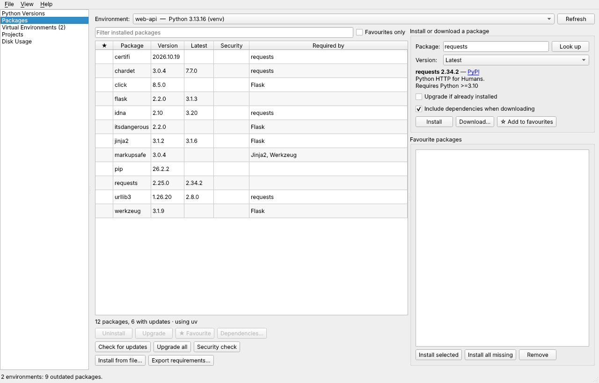
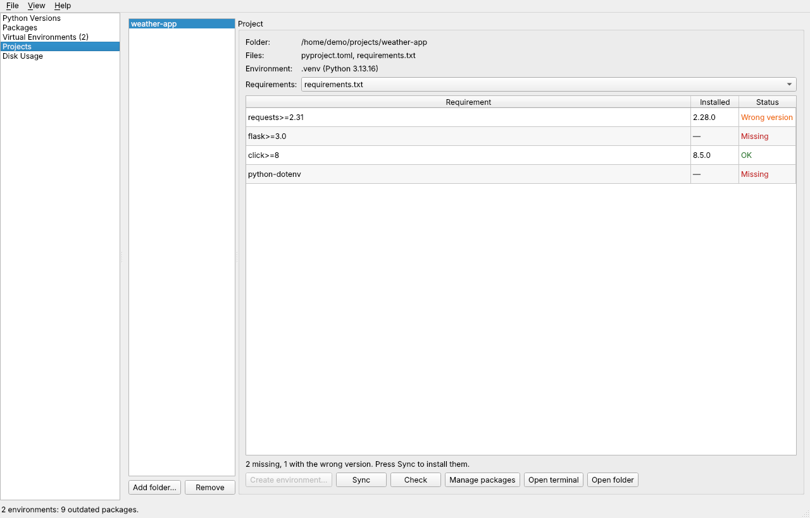
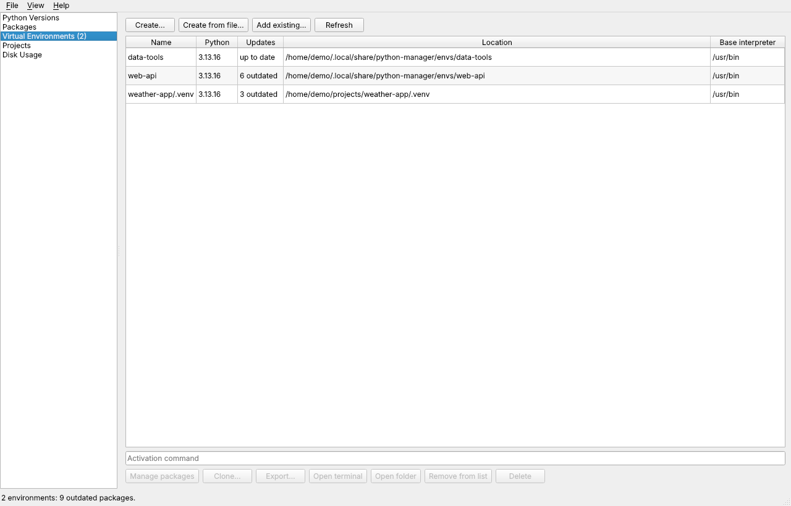
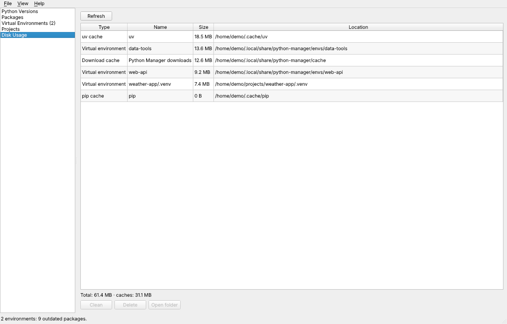

# Python Manager

A cross-platform desktop app (Windows, macOS, Linux) for managing Python from a UI:

- **Python versions** – browse, download, install and uninstall any CPython version
  (including pre-releases and free-threaded builds). Existing system Pythons are detected too.
  Installed Pythons with a newer patch release are flagged and updated in one click, and the
  environments on the old one can be rebuilt on the new one right away. A *Support* column shows
  which Pythons and environments are past end of life or will be within six months.
- **Packages** – list, install (any version from PyPI), upgrade, uninstall and download packages
  for any interpreter or virtual environment. Install from a wheel or sdist, or from a
  `requirements.txt`, `pyproject.toml` (with chosen extras and dependency groups) or `pylock.toml`
  after a preview of what is missing, at the wrong version or already satisfied; check for updates
  and export the environment. A *Size* column shows the disk space of each
  package. Package names autocomplete from the full PyPI list.
- **Compare and find** – *Compare…* shows two environments' packages side by side (different
  version, only on one side) and installs the left side's versions on the right in one click.
  *Find package…* lists every interpreter and environment that has a package (name, part of it or
  a pattern such as `django-*`).
- **Package history** – a snapshot of an environment's packages is saved before every install,
  upgrade or uninstall made with the app. *History…* on the Packages page lists them and restores
  one: its versions are installed and packages added since are removed.
- **Update all** – one click lists every outdated package with its installed and new version,
  flags major versions and, on the Projects page, updates the project's requirements exclude.
  Untick what to keep, update the rest, and see what changed plus any broken requirements.
- **Export / lock** – save any environment as `requirements.txt` (all packages or top-level only,
  pinned), `requirements.txt` with hashes, a [PEP 751](https://peps.python.org/pep-0751/)
  `pylock.toml` lock file, `pyproject.toml`, or a [CycloneDX](https://cyclonedx.org) JSON SBOM with
  each package's purl, licence, dependencies and PyPI file hashes. From the Projects page the file is saved into the
  project folder.
- **Security check** – look up known vulnerabilities in the installed packages in the
  [OSV database](https://osv.dev), see severity and fixed versions, and upgrade to fixed versions.
- **Dependencies** – see what each package requires and what requires it (tree view and a
  "Required by" column). Uninstalling warns about packages that still depend on the selection and
  offers to remove dependencies that are no longer needed.
- **Fast backend** – uses [uv](https://docs.astral.sh/uv/) for installs and environment creation when
  it is on `PATH` (toggle in *File → Settings*), falling back to pip and `venv`.
- **Favourite packages** – star any package; favourites are shown with ★, can be filtered,
  installed into any environment in one click, and optionally installed into new environments.
- **Virtual environments** – create environments from any installed Python, manage their packages,
  open an activated terminal, add existing environments or delete them. Clone an environment
  (optionally onto another Python), update or export it, and create a new environment from a
  `requirements.txt` or `pyproject.toml`. *Rebuild…* recreates an environment in the same folder
  on another Python with the same packages, also when its old Python is gone.
- **Projects** – add a project folder with `pyproject.toml`, `requirements.txt` or `uv.lock`. The app
  finds its environment (`.venv`, `venv` or `env`) or creates `.venv`, lists each requirement as
  OK, missing or wrong version, and syncs it in one click (`uv sync --frozen` when there is a
  `uv.lock` and uv is installed). Compare against any `requirements*.txt`, or `pyproject.toml` with
  an extra, a dependency group (PEP 735) or all of them; installed packages the requirements do not
  list are shown too. The comparison refreshes when a requirements file or the environment changes.
  The Python the project asks for (`.python-version`, `requires-python`) is shown, can be set, and is
  preselected for a new environment; an environment on another Python is flagged. When no installed
  Python fits, *Create environment…* downloads and installs a matching one and creates the
  environment on it.
  *Check imports…* scans the project's code and lists imports no installed package provides,
  imports from packages the requirements do not declare, and requirements the code never imports.
- **Tools** – command-line tools installed with `uv tool` or pipx in one list, with their commands,
  Python and the latest version on PyPI. Install a tool (optionally on a chosen Python), upgrade
  one or all, or uninstall it.
- **Jupyter kernels** – add an environment to Jupyter in one click (ipykernel is installed when
  missing) or remove it again; see every installed kernel and clean up those whose Python is gone.
- **License report** – *Licenses…* on the Packages page lists each package's licence and whether
  it is permissive, weak copyleft or copyleft; filter it and save the report as CSV, Markdown or JSON.
- **Conda environments** – conda, mamba and micromamba environments are listed read-only on the
  Virtual Environments page with their activation command; their packages can be viewed but are
  changed with conda.
- **Scheduled checks** – every environment is checked in the background (daily by default) for
  outdated and vulnerable packages. Results show in an *Updates* column, as a count next to
  *Virtual Environments* and in a desktop notification (*File → Check environments now*).
- **Disk usage** – size of every environment, installed Python, the download cache and the pip and
  uv caches; clean a cache or delete environments from the same page. Environments whose Python is
  gone or that have not changed for a long time are flagged, and *Select stale* selects them all.
  Each downloaded Python archive has its own row; *Select old downloads…* selects those already
  installed or older than a chosen number of days.
- **Settings** – *File → Settings*: light, dark or system theme, uv on or off, a private package
  index or mirror (with extra indexes and trusted hosts), the default Python and folder for new
  environments, how often environments are checked, whether the check includes the security
  lookup and shows notifications, and when an environment counts as stale.
- **Log file** – everything shown in the Output panel, plus errors, is written to a rotating log
  (*File → Open log file*) to attach to bug reports.

## Screenshots

| Packages | Projects |
|---|---|
|  |  |
| **Virtual environments** | **Disk usage** |
|  |  |

## Run

```bash
python -m venv .venv
# Windows: .venv\Scripts\activate    macOS/Linux: source .venv/bin/activate
pip install -e .[dev]
python-manager          # or: python -m python_manager
```

Requires Python 3.9+ and PySide6 (installed automatically).

## Command line

`python-manager-cli` uses the same data as the app and needs no display, so it works in scripts
and CI. Add `--json` to any command for machine-readable output.

```bash
python-manager-cli pythons              # installed and system Pythons (--managed: app-installed only)
python-manager-cli envs                 # virtual environments, broken and end-of-life ones flagged
python-manager-cli check [ENV ...]      # outdated and vulnerable packages (--no-security: skip OSV)
python-manager-cli imports [PROJECT]    # imports vs requirements (-r FILE, --python ENV)
python-manager-cli licenses [ENV]       # licence of each package (--format csv|markdown|json,
                                        #   --fail-on copyleft,weak-copyleft,other,unknown)
python-manager-cli export [ENV]         # save the packages (--format pinned|top|hashes|pylock|pyproject|sbom, -o FILE)
```

`ENV` is an interpreter, an environment folder or an environment's name; `licenses` and `export`
default to the current folder's `.venv`, `venv` or `env`. `check` exits with 1 when something
needs attention and 2 when a check failed; `imports` exits with 1 when an import is not installed
or not declared; `licenses` exits with 1 when a package is in a `--fail-on` category.

## How it works

| Feature | Implementation |
|---|---|
| Python downloads | Relocatable CPython builds from [python-build-standalone](https://github.com/astral-sh/python-build-standalone), verified with SHA-256 and extracted into the app data folder. Uninstall removes that folder. No admin rights needed. |
| Packages | `uv pip … --python <interpreter>` when uv is available, otherwise the interpreter's own `pip`; version details come from the PyPI JSON API. Downloads always use pip. |
| Package index | The index settings are passed to every pip, uv and pipx command as `PIP_INDEX_URL`, `PIP_EXTRA_INDEX_URL`, `PIP_TRUSTED_HOST` and their `UV_*` equivalents. Version details and autocomplete still come from PyPI. |
| End of life | A built-in table of each CPython minor version's end of security support (from the [Python developer guide](https://devguide.python.org/versions/)); nothing is looked up online. Versions newer than the table count as supported. |
| Python updates | An installed Python is flagged when the build list has a newer patch release of the same minor version and variant. The update is installed next to it; environments keep using the old one until they are rebuilt on the new one. |
| Rebuild | The pinned package list is read (`pip freeze`, or the metadata in site-packages when the environment's Python is gone), the old folder is moved aside, a new environment is created at the same path and the packages are installed. If that fails the old folder is put back. |
| Compare / find | Installed packages are read from each interpreter's metadata, as on the Packages page; names are compared after PEP 503 normalisation. |
| Package history | Name/version pairs from installed metadata, saved in `history/` in the app data folder (30 per environment). Restoring installs the pinned versions and uninstalls packages the snapshot did not have, except pip, setuptools and wheel. |
| Import check | The project's `.py` files (hidden folders, environments, `build` and `dist` skipped) are parsed with `ast`; imports inside `try`/`except ImportError` and the project's own modules are ignored. Modules are matched to packages with `top_level.txt` or `RECORD` inside the environment, and the standard library with `sys.stdlib_module_names`. |
| Package sizes | The sizes of the files each package's `RECORD` lists, read inside the environment; packages without a file list show no size. |
| Name autocomplete | PyPI's JSON simple index (`https://pypi.org/simple/`), cached in the app data folder and refreshed weekly. |
| Security check | Installed name/version pairs are sent to the OSV batch API (`api.osv.dev`); nothing else leaves the machine. |
| Dependencies | Read from installed package metadata (`importlib.metadata`) inside the target interpreter. |
| Virtual environments | `uv venv` when uv is available, otherwise standard library `venv`. |
| Projects | Requirements are read from `requirements.txt` (following `-r` includes), `pyproject.toml` or `pylock.toml` and compared with the environment's installed metadata; markers are evaluated for the environment's Python. |
| Scheduled checks | `pip list --outdated` plus the security check for each environment and app-installed Python, at most once a day; results are cached in `cache/health.json`. |
| Update all | `pip list --outdated` for the list, `pip install --upgrade` for the chosen packages, then `pip check` for broken requirements (uv equivalents when uv is used). |
| Export / lock | Versions come from installed metadata; hashes and file URLs for `pylock.toml` and hashed requirements come from the PyPI JSON API. Packages not on PyPI are left out and listed. The SBOM (CycloneDX 1.6) adds licences from installed metadata and keeps packages not on PyPI, without hashes. |
| Tools | `uv tool list --show-paths` and `pipx list --json`; install, upgrade and uninstall run the same manager's commands. Latest versions come from the PyPI JSON API. |
| Jupyter kernels | Kernel specs are read from Jupyter's `JUPYTER_PATH`, user and system data folders, in that order; adding one runs `python -m ipykernel install --user` in the environment, removing one deletes its folder. |
| Licenses | Read from installed metadata inside the environment: `License-Expression` (PEP 639) first, then `License ::` classifiers, then the `License` field. Nothing is sent over the network. |
| Conda | Found without running conda: `~/.conda/environments.txt`, `CONDA_PREFIX`, `CONDA_EXE`, `MAMBA_ROOT_PREFIX` and the usual install folders (`miniconda3`, `anaconda3`, `miniforge3`, …). The Python version is read from `conda-meta`. |
| Disk usage | Folder sizes without following symlinks. pip's cache honours `PIP_CACHE_DIR`; uv's comes from `uv cache dir` and is cleaned with `uv cache clean`. |

App data (installed Pythons, environments, download cache, `config.json`, `logs/`):

| OS | Folder |
|---|---|
| Windows | `%LOCALAPPDATA%\PythonManager` |
| macOS | `~/Library/Application Support/PythonManager` |
| Linux | `~/.local/share/python-manager` |

Set `PYTHON_MANAGER_HOME` to use another folder. Set `GITHUB_TOKEN` to raise the GitHub API rate limit
when listing many releases.

## Project layout

```
src/python_manager/
  core/   # UI-independent logic (no Qt): python_versions, packages, deps, venvs, projects, projectfile,
          # lock, security, licenses, sizes, compare, history, imports, health, disk, tools, conda,
          # kernels, eol, logs
  cli.py  # python-manager-cli
  ui/     # PySide6 widgets: one page per feature, background task runner
tests/    # pytest suite for core plus offscreen UI smoke tests
```

## Tests

```bash
pytest
```

UI tests build the windows offscreen (`QT_QPA_PLATFORM=offscreen` is set for you) and are skipped
when PySide6 is not installed.

## Download

Ready-to-run builds for Windows, macOS (Apple silicon and Intel) and Linux are attached to each
[GitHub release](https://github.com/faheemkhaskheli9/python-manager/releases). Unzip and run
*Python Manager*; no Python installation is needed.

## Changelog

See [CHANGELOG.md](CHANGELOG.md). Every pull request adds its entries under **Unreleased**, each
ending with the PR number, e.g. `([#12])`; CI fails otherwise (label `skip-changelog` for
changes users never notice).

## Release

Rename **Unreleased** in `CHANGELOG.md` to the new version (e.g. `## [0.2.0] - 2026-11-01`),
bump `version` in `pyproject.toml` and `src/python_manager/__init__.py`, then push a version tag; the `release` workflow builds every platform with PyInstaller and publishes
a release with the archives, using that changelog section as release notes:

```bash
git tag v0.2.0 && git push origin v0.2.0
```

Build locally:

```bash
pip install . pyinstaller
pyinstaller --noconfirm --windowed --name "Python Manager" --collect-submodules python_manager src/python_manager/__main__.py
```
